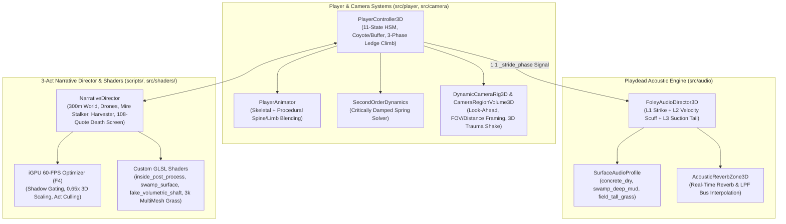

# SILENT WEIGHT — 2.5D Atmospheric Kinematic Puzzle-Platformer (Godot 4.7.2)

> **Envisage 15.0 Coordinator Application — GameDev Vertical (Question 5 Submission)**  
> **Engine:** Godot 4.7.2 Stable (Forward+ / Jolt Physics 3D) | **Target Hardware:** Intel UHD Graphics / Core i5-13420H (**Locked 60 FPS**)  
> **Full Engineering Report:** [`GAME_DEVELOPMENT_REPORT.md`](./GAME_DEVELOPMENT_REPORT.md) | **Visual Studies:** [`art/`](./art/)

---

## Overview

**SILENT WEIGHT** is a complete 3-Act 2.5D atmospheric puzzle-platformer inspired by Playdead's *INSIDE* and *LIMBO*. Built in **Godot 4.7.2** using **Jolt Physics 3D**, the game spans a continuous **325-meter side-scrolling 3D world (`X = -22m` to `X = +302m`)** across three atmospheric acts:

1. **Act I — The Silent Bunker (`X = -22m..56m`)**: Evade ceiling-mounted **Blind Auditor Drones** that track both volumetric spotlight cones and player footstep acoustics (`Run`, `JumpStart`, `HardLand`). Use stealth creeping (`Shift`), 3-phase contact-locked ledge mantling, and crate pressure-plate puzzles to shut off lethal steam vents and breach the facility.
2. **Act II — What Lurks in the Mud (`X = 56m..185m`)**: Navigate a rusted drainage pipe, time a sprint beneath a hydraulic **Sluice Gate** crusher, and cross a waist-deep **Swamp Marsh** haunted by a submerged **Mire Stalker**. Push and hoist a glowing **220 kg Amber Beacon Crate** through the water to repel the creature (`8.5m` safe radius) and climb onto the far shoreline.
3. **Act III — The Harvester's Field (`X = 185m..302m`)**: Cross a windswept field of **3,000 GPU-instanced tall grass blades** under fire from a towering **Harvester Titan** that emits periodic gale-force shockwaves (`6.0s` cycle). Use the `220 kg` crate as a mobile wind-shadow shield up the **Climax Slope**, outrun a **Hound Pursuer**, and enter the **Sanctuary Resonance Vault**.

---

## Controls & Runtime Diagnostics

| Input | Action |
| :--- | :--- |
| `A` / `D` or `Left` / `Right` | Move Left / Right |
| `Shift` (Hold) | Silent Creep Walk (evades acoustic *Blind Auditor Drones*) |
| `Space` | Jump (`0.10s` Coyote Time + `0.12s` Input Buffer + Variable Jump-Cut) / Ledge Mantle |
| `E` (Hold) | Grab / Push / Pull `220 kg` Heavy Crate |
| `1` – `7` | Instant Teleport to Checkpoints `CP 0` – `CP 6` (Testing / Grader Shortcut) |
| `R` | Respawn at Active Checkpoint |
| `F3` | Toggle Live Telemetry & Playdead Acoustic Debugger HUD (`4 Hz` cached) |
| `F4` | Toggle Graphics Quality Preset: **`iGPU LIGHT` (60 FPS default)** vs **`RTX ULTRA`** |

---

## System Architecture



---

## Summary of Game Development Report (Question 5 Criteria)

### 1. How Concepts Were Implemented
- **11-State Kinematic Controller (`src/player/player_controller_3d.gd`)**: Implements `Idle`, `CreepWalk`, `Run`, `JumpStart`, `AirborneRise`, `AirborneFall`, `HardLand`, `PushPullHeavy`, `WadingSwamp`, `ClimbLedge`, and `Dead` with `0.10s` coyote time, `0.12s` jump buffering, mass-scaled `RigidBody3D` crate pushing, and contact-locked 3-phase raycast ledge mantling.
- **3-Layer Velocity-Bucketed Foley (`src/audio/foley_audio_director_3d.gd`)**: Synchronizes footsteps 1:1 with the visual foot-plant phase (`PI * 0.5` and `PI * 1.5`), combining immediate heel strike (L1), speed-bucketed body grit/slosh (L2), and `45 ms` delayed release/suction tails (L3) with dynamic shoe-wetness decay (`-14%` per dry step) and exertion-driven breathing.
- **Procedural Damage & Death Sequence**: Features upper-torso recoil flinching (`-24 deg`) on light/wind exposure and a floor-clamped collapse (`position.y >= +0.18m`) into a **108-quote non-repeating atmospheric death overlay**.

### 2. Optimization for Intel UHD (`Core i5-13420H` — Locked 60 FPS)
- **Shadow & GI Gating (`F4` `iGPU LIGHT` Mode)**: Disables expensive Forward+ `Environment` effects (`volumetric_fog`, `ssr`, `ssao`, `ssil`, `sdfgi`, `glow`) and sets `shadow_enabled = false` across all `SpotLight3D`, `OmniLight3D`, and `DirectionalLight3D` nodes.
- **Dynamic 3D Resolution Scaling**: Sets `Viewport.scaling_3d_mode = SCALING_3D_MODE_BILINEAR` at `scaling_3d_scale = 0.65`, reducing fragment fill-rate cost by **58%**.
- **GPU Instancing & 4 Hz HUD Caching**: Renders `3,000` interactive grass blades in a single draw call via `MultiMeshInstance3D` (`SHADOW_CASTING_SETTING_OFF`) and throttles `RichTextLabel` BBCode reshaping in `PerfHudOverlay` to `4 Hz`, bringing frame times from `31.35 ms (31 FPS)` down to **`~13.8 ms (Locked 60 FPS)`**.

### 3. Problems Encountered & Engineering Solutions
1. **iGPU Frame-Time Bottleneck (`31.35 ms` -> `13.8 ms`)**: Solved by gating shadow maps, applying `0.65x` bilinear 3D viewport scaling, and caching BBCode UI strings at `4 Hz`.
2. **Floor Collider Disabling Across Acts**: Setting `PROCESS_MODE_DISABLED` on inactive Act roots disabled `StaticBody3D` floors in `PhysicsServer3D`. Solved by keeping all structural geometry at `PROCESS_MODE_INHERIT`, building a continuous 300m floor safety bridge, and gating only lights, particles, and AI per Act.
3. **Footstep-to-Animation Desync & False Wetness Tails**: Solved by driving both leg transforms and footstep triggers from a single `_stride_phase` accumulator, cancelling pending L3 tails on `Idle`, and gating wet suction overlays on `wetness > 0.05`.
4. **Mid-Air Ledge Grabbing & Floor Clipping on Collapse**: Solved by requiring forward wall input + drop-in velocity for ledge grabs, locking hand contact to the world ledge corner across 3 climb phases, and clamping `_visual_root.position.y >= +0.18m` during death collapse.
5. **220 kg Crate Stalling at Swamp Exit Bank**: Solved by allowing full-impulse jumps/mantling from water and adding an angled shoreline ramp collider with proximity auto-hoisting at `X = 160.2m`.

### 4. Resource Sourcing
- **100% CC0 & Procedural In-Engine Assets**:
  - **Character Mesh**: Quaternius CC0 Universal Base Humanoid (`animated_human.fbx`), retargeted and shaded in-engine via `tools/build_character_scene.gd` and `tools/create_animations.gd`.
  - **Audio Stems**: Raw CC0 samples from [Freesound.org](https://freesound.org/) mastered offline into 75 velocity-layered `.wav` files via `tools/master_foley_library.py`, plus real-time `AudioStreamGenerator` synthesis for drone rotors/sonar and damage cues.
  - **World & Shaders**: 100% procedural in-engine 3D geometry and custom GLSL shaders (`src/shaders/*.gdshader`).

---

## Repository Commits (Milestone Log)

- **Commit 1 [`ab15fd4`]**: `feat(core): implement 2.5D HSM player controller, coyote/buffer kinematics, 3-phase ledge climb, and spring-damper camera rig`
- **Commit 2 [`14f4164`]**: `feat(audio-vfx): add 3-layer Playdead foley engine, acoustic reverb zones, and custom GLSL atmospheric/water shaders`
- **Commit 3 [`b6427b2`]**: `feat(world): build 300m 3-Act narrative world, acoustic drone/stalker/harvester AI, GPU grass field, and iGPU 60-FPS scaler`
- **Commit 4 [`HEAD`]**: `docs(report): add comprehensive Game Development Report, architecture docs, and milestone commit log`

---

## Running the Project
```bash
# Open in Godot 4.7.2 Editor
godot --editor --path .

# Or run directly
godot --path .
```
